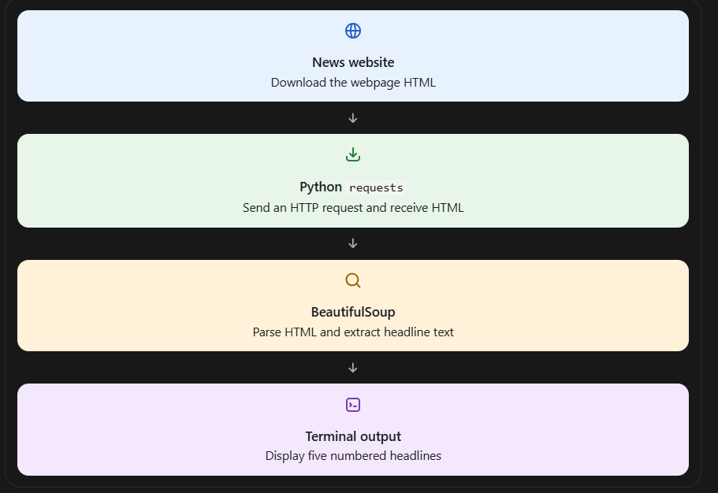

1. Understand the workflow

2. Set up your project on Windows
Open Command Prompt or PowerShell.

Create a folder for the assignment:
mkdir headlines-assignment
cd headlines-assignment

Check that Python is installed:
python --version

You should see a Python version, such as Python 3.12.x or later. If python is not recognized, try py --version.

Install the required libraries:
python -m pip install requests beautifulsoup4

These libraries serve different purposes:
- requests — retrieves the webpage.
- beautifulsoup4 — extracts information from the HTML.
3. Create headlines.py
Open Notepad or Visual Studio Code. Create a new file named headlines.py inside your headlines-assignment folder.

Copy and paste this complete code.
import requestsfrom bs4 import BeautifulSoup# News website to scrapeURL = "https://www.bbc.com/news"# Identify the request as coming from a browserHEADERS = {    "User-Agent": "Mozilla/5.0 (Windows NT 10.0; Win64; x64) "                  "AppleWebKit/537.36 Chrome/130.0.0.0 Safari/537.36"}def get_headlines():    try:        # Step 1: Fetch the webpage        response = requests.get(            URL,            headers=HEADERS,            timeout=15        )        # Stop if the website returns an HTTP error        response.raise_for_status()        # Step 2: Parse the HTML        soup = BeautifulSoup(response.text, "html.parser")        # Step 3: Find headline elements        headline_elements = soup.find_all(["h2", "h3"])        # Step 4: Clean and remove duplicate headlines        headlines = []        seen = set()        for element in headline_elements:            headline = element.get_text(" ", strip=True)            if headline and headline not in seen:                seen.add(headline)                headlines.append(headline)            if len(headlines) == 5:

Save the file as headlines.py. In Notepad, select Save as type: All files so that it doesn't become headlines.py.txt.
4. Run the script
In PowerShell, make sure you are inside the project folder, then run:
python headlines.py

If you use the Python launcher instead, run:
py headlines.py

5. Expected output
Your actual headlines will depend on what BBC News publishes when you run the script. For example, the output format should look like this:
Top 5 Headlines from BBC News
----------------------------------------
1. Example headline about world news
2. Example headline about technology
3. Example headline about business
4. Example headline about science
5. Example headline about international affairs

These are illustrative headlines, not live results. Your program should print the actual text it retrieves.

If you see No headlines found, the BBC page structure may have changed or the site may not have returned the expected HTML. If you see a timeout or HTTP error, check your internet connection and try again.
6. Test your assignment
Run through this checklist before submitting.
Assignment checklist

7 of 7

[x] Python is installed and the required libraries are installed
[x] File is saved as headlines.py
[x] The script retrieves a webpage using requests.get()
[x] BeautifulSoup parses the HTML
[x] Five headlines are printed with numbering from 1 to 5
[x] Errors are handled without an unhandled traceback
[x] The terminal screenshot shows the actual program output

7. Capture your submission
The assignment asks for three deliverables:
1. Terminal screenshot: Run python headlines.py and take a screenshot showing the five actual headlines.
2. Python script: Submit your headlines.py file.
3. Screen recording: Record yourself running the script and showing the output.
You can keep everything organized like this:
headlines-assignment/
│
├── headlines.py
├── screenshot.png
└── README.md